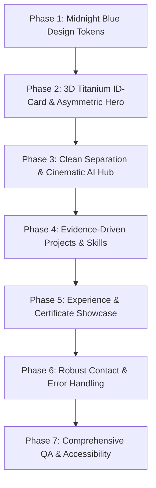

# Proposed Implementation Plan — 7-Phase Execution

---

### Phase 1: Midnight Blue Design System Upgrade
- Define CSS custom properties:
  - Deep background: `#070D1A`
  - Midnight surface: `#0C1730`
  - Raised surface: `#132342`
  - Primary text: `#F4F7FC`
  - Secondary text: `#A9B6CC`
  - Blue accent: `#68A8FF`
  - Cyan highlight: `#8AE5F4`
  - Titanium border: `rgba(169, 182, 204, 0.2)`
- Refine light mode to pale blue/neutral surfaces and navy text.
- Preserve modern typography, accessible contrast, and smooth micro-interactions.

### Phase 2: Asymmetric Hero with Physical 3D Titanium ID-Card
- Left side:
  - Name: Harshit Mishra
  - Title: Data Analytics | AI Enthusiast
  - Tagline: "Building intelligent digital experiences."
  - Primary CTA: "Explore Work" + Secondary CTA: "Contact"
- Center-Right side:
  - Realistic 3D Titanium ID-Card with chamfered metal rim, metallic sheen glare, subtle lanyard/chip detailing, and authentic photo `image.png`.
  - Realistic cursor-following tilt & touch physics, with full WebGL/CSS fallback.
  - Native scrolling preserved (no scroll hijacking).

### Phase 3: Dedicated Cinematic AI Hub (`ai-hub.html`)
- Build a dedicated, cinematic page `ai-hub.html`.
- Incorporate the hand-crafted silver robot mascot with blue visor (`assets/robot_mascot.svg`) with interactive micro-animations.
- Cards:
  - **N8N Workflow Automation:** Background and capabilities, truthful public deployment status.
  - **NIVA Personal Assistant:** Natural Intelligent Virtual Assistant architecture.
- Navigation link in the main navbar & hero with return link to portfolio.

### Phase 4: Truthful Projects & Technical Arsenal
- Clean up project cards: show verified problem/goal, stack, live/repo links.
- Remove synthetic percentages from skills; organize into verified competency clusters:
  - Programming & Core
  - Machine Learning & Data Science
  - Computer Vision & NLP
  - Web & Tools

### Phase 5: Experience & Certificates Refinement
- Timeline with verified Inamigos Foundation and InternPe internships.
- Interactive certificate viewer showcasing authentic certificates.

### Phase 6: Contact & Error Handling
- Validate form inputs client and server side.
- Show delivery confirmation only on success.
- Graceful error states with direct email (`harshitmishra1208@gmail.com`) and LinkedIn fallbacks.

### Phase 7: QA, Accessibility & Verification
- Test reduced motion (`prefers-reduced-motion`).
- Verify keyboard navigation, tab order, and screen reader labels.
- Run local server test and verify in browser subagent.
